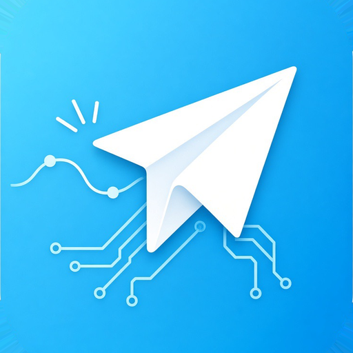

<p align="center">
  
</p>

<h1 align="center">TelegraPh</h1>

<p align="center">
  Клиент Telegram для старых iPhone — <b>iOS 5.0+</b> (armv7), проверен на iPhone 3GS.<br>
  <a href="README.md">English version</a>
</p>

---

## Возможности

- Работает на iOS 5.0 и новее, устройства armv7 (iPhone 3GS и новее)
- Чаты, группы, каналы, секретные чаты, голосовые, стикеры, звонки
- Прокси (SOCKS5, WebSocket, подписки VLESS)
- Маршрутизация через Cloudflare WARP
- Классический интерфейс в стиле iOS 6
- Языки: English, Русский, Deutsch, Español, Italiano, Nederlands, Português, 한국어, العربية

## Требования

| | |
|---|---|
| Устройство | iPhone 3GS или новее (armv7) |
| iOS | 5.0 или новее |
| Джейлбрейк | **Обязателен** (приложение не подписано Apple) |
| Установщик | AppSync Unified (или аналог) |

## Установка

1. Сделайте джейлбрейк и установите **AppSync** из Cydia.
2. Скачайте `TelegraPh-iOS5_0-armv7.ipa` на странице [Releases](../../releases).
3. Установите одним из способов:
   - **iFile / Filza:** скопируйте `.ipa` на устройство, откройте и нажмите *Install*.
   - **iTunes / 3uTools / iFunBox:** перетащите `.ipa` на устройство.
   - **SSH:** `ipainstaller TelegraPh-iOS5_0-armv7.ipa`
4. Сделайте respring. TelegraPh появится на домашнем экране.

Если приложение падает при запуске, подпишите его заново:

```sh
ldid -S Payload/TelegraPh.app/Telegram
```

## Примечания

- Bundle ID — `dev.telegraph.client`. Он отличается от прошлых сборок, поэтому нужно войти в аккаунт заново.
- Исполняемый файл внутри бандла по-прежнему называется `Telegram`, так задумано.
- Автообновление отключено.

## Авторство и лицензия

TelegraPh — модифицированная сборка на основе открытого Telegram для iOS и его форков сообщества.
Telegram для iOS распространяется под **GPL-2.0**, поэтому проект и его исходники должны оставаться под совместимой лицензией с сохранением оригинальных уведомлений об авторских правах.

Проект не связан с Telegram FZ-LLC и не одобрен ею. «Telegram» — товарный знак его владельца.

## Документация

- [Решение проблем](TROUBLESHOOTING.md)
- [Участие](CONTRIBUTING.md)
- [Политика безопасности](SECURITY.md)
- [Кодекс поведения](CODE_OF_CONDUCT.md)
- [История изменений](CHANGELOG.md)

## Участие

Сообщения об ошибках приветствуются — используйте [шаблоны issue](.github/ISSUE_TEMPLATE) и укажите модель устройства и версию iOS.
